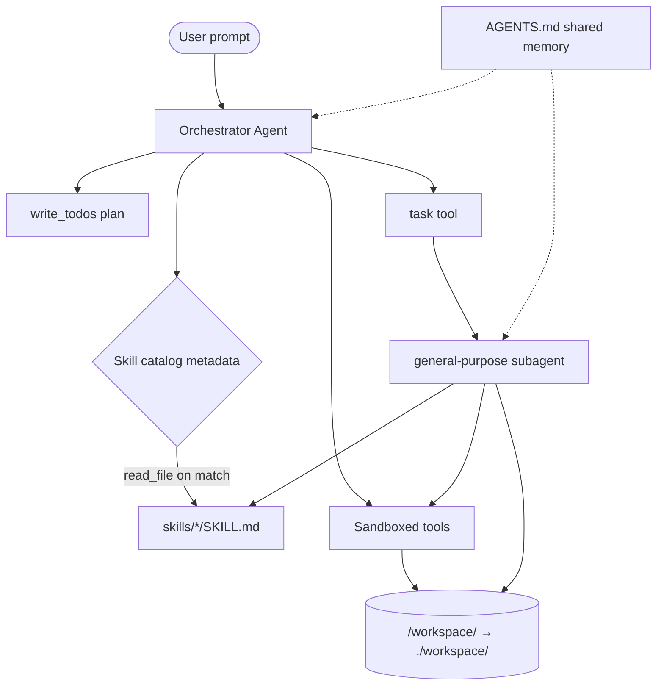

# Deep Agents with LangChain

<p align="center">
  
  
  
</p>

> A generic orchestrator + **SKILL.md** skills + **AGENTS.md** shared memory — autonomous agents that plan, delegate, and collaborate through the filesystem.

This project demonstrates the **Deep Agent** pattern from LangChain: no hardcoded specialist chains, no custom routers. The LLM discovers capabilities at runtime, loads skill playbooks on demand, and spawns subagents for multi-step work.

## Why this pattern?

| Shallow agent | Deep agent (this repo) |
|---------------|------------------------|
| Fixed tools baked into code | Skills added as folders — zero code changes |
| Single-thread reasoning | Planning + subagent delegation |
| Context only in chat history | Persistent handoffs in `/workspace/` (project `workspace/` folder) |
| Custom routing logic | LLM routes via skill **descriptions** |

## Architecture



### Four pillars in action

1. **Planning** — `write_todos` decomposes complex goals.
2. **Delegation** — `task` spawns isolated subagents with the same skill library.
3. **Progressive disclosure** — Only skill `name` + `description` load at startup; full `SKILL.md` loads when needed.
4. **Filesystem workspace** — Research, drafts, charts, tests, and deploy bundles pass between agents as files under `/workspace/`.

## Skills catalog

Nine skills ship with the repo. Each follows the [Agent Skills spec](https://agentskills.io): `SKILL.md` plus optional `scripts/`, `references/`, and `assets/`.

| Skill | Use when | Key tool / output |
|-------|----------|-------------------|
| `research` | Web research, competitive intel | `internet_search` → `research_*.md` (cited, ≤250 lines) |
| `writer` | Blog posts, reports from notes | → `draft_*.md` |
| `data-analyst` | CSV stats, executive analysis | `run_data_analysis` → `analysis_*.md` + charts |
| `chart-generator` | Plot/chart/graph only (no full report) | `generate_chart` → `charts/*.png` |
| `code-generator` | New Python scripts in workspace | → `*.py` (no duplication) |
| `test-runner` | Verify generated code | `run_workspace_tests` → `test_report_*.md` |
| `code-reviewer` | Security, bugs, maintainability | → `review_*.md` |
| `static-deploy` | Publish markdown to free hosting | `deploy_static_site` → Netlify URL |
| `web-quality` | SEO & accessibility audit after deploy | `check_web_quality` → `quality_report_*.md` |

**Chart vs analysis:** use `chart-generator` for “make a chart”; use `data-analyst` for “analyze this CSV” with stats and a written report. Do not hand-write matplotlib scripts in workspace — use the tools.

## Project structure

```
deep-agents/
├── AGENTS.md                 # Shared team conventions (always loaded)
├── agent.py                  # Generic orchestrator factory
├── config.py                 # Defaults (models, paths)
├── server.py                 # FastAPI backend + SSE streaming
├── frontend/                 # React + Tailwind UI
│   └── src/data/suggestedPrompts.ts   # Per-skill sample tasks
├── services/
│   ├── agent_service.py      # SSE streaming, failover loop
│   ├── llm_failover.py       # Multi-provider model chain
│   ├── sandbox_runner.py     # Workspace-locked subprocess execution
│   ├── data_analysis.py      # run_data_analysis
│   ├── chart_generator.py    # generate_chart
│   ├── test_runner.py        # run_workspace_tests
│   ├── web_quality.py        # check_web_quality
│   ├── static_deploy.py      # deploy_static_site
│   ├── run_history.py        # Saved runs under ./runs/
│   └── project_data.py       # Workspace + skills API helpers
├── skills/                   # One folder per skill (see catalog above)
├── workspace/                # Agent artifacts (not app source code)
├── runs/                     # Orchestration run history
├── scripts/run.sh            # Build frontend + start server (port fallback)
├── app.py                    # Legacy Streamlit UI (optional)
├── main.py                   # CLI runner
├── requirements.txt
└── .env.example
```

## Quick start

### Prerequisites

- Python 3.12+
- Node.js 20+ (for the React UI)
- [Anthropic](https://console.anthropic.com/) **or** [OpenAI](https://platform.openai.com/) API key
- [Tavily](https://tavily.com/) API key (for the research skill)

### Setup

```bash
cd langchain/deep-agents
python -m venv .venv
source .venv/bin/activate   # Windows: .venv\Scripts\activate
pip install -r requirements.txt
cp .env.example .env        # add your API keys
```

### Run (React UI — recommended)

**Production-style** (builds React, serves from FastAPI on one port):

```bash
chmod +x scripts/run.sh
./scripts/run.sh
```

Open `http://localhost:8000` (if port 8000 is busy, `run.sh` falls back to **8001** — check terminal output).

**Development** (hot reload for UI):

```bash
# Terminal 1 — API
python server.py

# Terminal 2 — React dev server (proxies /api to :8000)
cd frontend && npm install && npm run dev
```

Open `http://localhost:5173`.

### UI features

- **Sample tasks grid** — one clickable prompt per skill (+ full pipeline), shown on empty chat
- **Browse samples** — return to the sample grid after a chat (top-right of chat panel)
- **Chat panel** — markdown rendering, thread continuity via `thread_id`
- **Orchestration pipeline** — plan → skills → subagents → workspace (with artifact diff)
- **Live activity feed** — thoughts, tool calls, skill loads, delegations, deploy events
- **Live site banner** — persistent Netlify URL from the latest `deploy_report_*.md`
- **Run history** — every chat saved under `./runs/{id}/` (replayable from sidebar)
- **Resizable sidebar** — drag the right edge on desktop to widen the Files tab
- **Sidebar tabs** — skills catalog, plan, workspace files, run history, AGENTS.md memory
- **Files tab** — auto-refreshes when agents write, analyze, chart, test, or deploy

### Run (Streamlit UI — legacy)

```bash
streamlit run app.py
```

Open `http://localhost:8501`.

### Run (CLI)

```bash
python main.py "Analyze workspace/sample_sales.csv and summarize trends"
# or interactive mode:
python main.py
```

## Using CSV data

There is no file-upload button yet. Add CSV files to the workspace folder:

```bash
cp ~/Downloads/my_data.csv workspace/my_data.csv
```

Then prompt: *"Analyze /workspace/my_data.csv"* or *"Generate a chart from sample_sales.csv"*.

A demo dataset is included: `workspace/sample_sales.csv`.

## Example prompts

Click any sample in the UI, or try:

```
Analyze workspace/sample_sales.csv and summarize revenue trends.
```

```
Generate a dual-line sales chart from sample_sales.csv — revenue and units by product.
```

```
Generate a Python script to check weather, then run tests and save the report.
```

```
Research multi-agent orchestration trends, draft a blog post, deploy to Netlify, and run a web quality audit.
```

```
Review workspace/check_weather.py for security issues and save findings.
```

## How skill routing works

There is **no classifier**. `create_deep_agent(skills=["./skills"])` injects skill metadata into the system prompt. The model reads the user message, picks a skill, and calls `read_file("skills/<name>/SKILL.md")`. Well-written `description` fields (with trigger phrases and "Do NOT use for…" boundaries) are the routing engine.

### Built-in tools

| Tool | Purpose |
|------|---------|
| `internet_search` | Tavily web search |
| `run_data_analysis` | Sandboxed pandas/matplotlib → report + charts |
| `generate_chart` | Line, bar, scatter, dual-line charts → `charts/*.png` |
| `run_workspace_tests` | Pytest or smoke test → `test_report_*.md` |
| `check_web_quality` | SEO/a11y score → `quality_report_*.md` |
| `deploy_static_site` | Markdown → HTML → Netlify |

Custom tools require registering in `agent.py`. Skills only need a new folder under `skills/`.

## Workspace paths

Agents use **virtual paths** like `/workspace/draft_topic.md`. The backend maps these to `./workspace/` on disk.

| Path | Purpose |
|------|---------|
| `/workspace/research_<topic>.md` | Research notes (cited, ≤250 lines) |
| `/workspace/draft_<topic>.md` | Blog drafts |
| `/workspace/analysis_<topic>.md` | CSV analysis reports |
| `/workspace/charts/*.png` | Chart outputs |
| `/workspace/test_report_<name>.md` | Test run results |
| `/workspace/quality_report_<slug>.md` | SEO/a11y audit |
| `/workspace/review_<target>.md` | Code review output |
| `/workspace/sites/<slug>/index.html` | Static site bundle |
| `/workspace/deploy_report_<slug>.md` | Deploy log + live URL |
| `/workspace/<name>.py` | Generated scripts (avoid duplicate chart scripts) |

**Cleanup tip:** one-off `*chart*.py` scripts in workspace are obsolete once `chart-generator` is available — safe to delete. Avoid nested `workspace/workspace/` paths (agent path bug).

## Autonomous deployment

For prompts like *"research, write, and deploy to a free cloud page"*:

1. Agents **must not ask** which platform to use — default is **Netlify** (`static-deploy` skill).
2. `deploy_static_site` converts markdown → HTML, saves under `workspace/sites/<slug>/`, and publishes when configured.
3. `check_web_quality` runs after deploy when publishing.
4. Deploy bundles include Netlify `_headers` so HTML is served with correct `Content-Type`.

```
Research → write draft → deploy_static_site → check_web_quality → live URL + quality score
```

### Netlify setup

1. Create a free account at [app.netlify.com](https://app.netlify.com).
2. Generate a **Personal Access Token**: [User settings → Applications](https://app.netlify.com/user/applications#personal-access-tokens).
3. Add to `.env`:

```env
NETLIFY_AUTH_TOKEN=nfp_xxxxxxxx
NETLIFY_SITE_ID=your-site-id   # optional — reuse same site on redeploy
DEPLOY_PLATFORM=netlify
```

Without `NETLIFY_AUTH_TOKEN`, the static bundle and `deploy_report_*.md` are still created locally; only the live publish is skipped.

## Adding a new skill

1. Create `skills/my-skill/SKILL.md` with YAML frontmatter (`name`, `description`) and instructions.
2. Optionally add `scripts/`, `references/`, or `assets/` per the Agent Skills spec.
3. Add a sample prompt in `frontend/src/data/suggestedPrompts.ts`.
4. Restart the app.

No changes to `agent.py` are required unless the skill needs a new custom tool.

## Environment variables

| Variable | Required | Description |
|----------|----------|-------------|
| `ANTHROPIC_API_KEY` | One of Anthropic/OpenAI | Claude models |
| `OPENAI_API_KEY` | One of Anthropic/OpenAI | GPT models |
| `LLM_PROVIDER` | No | `auto`, `openai`, or `anthropic` (default `auto`) |
| `TAVILY_API_KEY` | For research | Web search tool |
| `WORKSPACE_ROOT` | No | Default `./workspace` |
| `RUNS_ROOT` | No | Default `./runs` |
| `DEPLOY_PLATFORM` | No | Default `netlify` |
| `NETLIFY_AUTH_TOKEN` | For live deploy | Netlify personal access token |
| `NETLIFY_SITE_ID` | No | Reuse existing Netlify site on redeploy |
| `ANTHROPIC_MODEL` | No | Default `claude-haiku-4-5-20251001` (auto-discovered from account) |
| `OPENAI_MODEL` | No | Default `gpt-4o-mini` |
| `GOOGLE_API_KEY` | For free failover | Gemini ([AI Studio key](https://aistudio.google.com/apikey)) |
| `GOOGLE_MODEL` | No | Default `gemini-2.5-flash-lite` |
| `LLM_FAILOVER` | No | Auto-switch models on errors (default `true`) |
| `LLM_FAILOVER_INCLUDE_GOOGLE` | No | Include Gemini in chain (default `true`; set `false` if quota exhausted) |
| `LLM_FAILOVER_MODELS` | No | Custom chain, e.g. `anthropic:claude-haiku-4-5-20251001,openai:gpt-4o-mini` |
| `SANDBOX_TIMEOUT_SECONDS` | No | Subprocess timeout for analysis/tests (default `60`) |

## Rate limits, quota, and failover

Deep agents make **many** LLM calls (planning, tools, subagents), so provider limits are easy to hit.

| Error | Meaning | Fix |
|-------|---------|-----|
| `rate_limit_exceeded` | Tokens per minute | Wait ~60s; use `gpt-4o-mini`; failover to Anthropic |
| `insufficient_quota` | **OpenAI billing exhausted** | Add credits **or** set `LLM_PROVIDER=anthropic` |

On **429 / model errors**, the app automatically switches to the next model in the failover chain (shown in live activity). Check: `GET /api/health` → `failover_chain`.

**Recommended when OpenAI credits are low:**

```env
LLM_PROVIDER=anthropic
LLM_FAILOVER=true
LLM_FAILOVER_INCLUDE_GOOGLE=false
```

Restart the server after changing `.env`.

## Key dependencies

- [`deepagents`](https://github.com/langchain-ai/deepagents) — planning, filesystem tools, subagents, skill middleware
- [`langchain-anthropic`](https://python.langchain.com/) / `langchain-openai` / `langchain-google-genai` — model integrations
- [`tavily-python`](https://github.com/tavily-ai/tavily-python) — web search
- **pandas**, **matplotlib**, **pytest** — sandboxed data analysis and tests
- **React + Vite + Tailwind** — dashboard UI
- **FastAPI** — REST + SSE streaming API

## Further reading

- [Deep Agents overview — LangChain docs](https://docs.langchain.com/oss/python/deepagents/overview)
- [Deep Agents skills — LangChain docs](https://docs.langchain.com/oss/python/deepagents/skills)
- [Agent Skills specification](https://agentskills.io)

## License

MIT — see [LICENSE](LICENSE).

## Acknowledgments

- [LangChain / deepagents](https://github.com/langchain-ai/deepagents) — agent harness
